# AgriRisk-MA: segmentação espaço-temporal e delimitação de talhões em imagens de satélite para auditoria de declarações agrícolas

#### Aluna: [Ana Paula Santos Delfino](https://github.com/ana-delfino).
#### Orientador: Leonardo Mendoza.

---

Trabalho apresentado ao curso [Visão Computacional Master (VC Master)](https://ica.ele.puc-rio.br/cursos/computer-vision-master/) da PUC-Rio como pré-requisito para conclusão de curso.

- [Link para o código](agririsk_v2_pastis/).
- [Link para a apresentação técnica (PDF)](agririsk_v2_pastis/docs/AgriRisk_MA_v2_apresentacao.pdf) · [versão HTML interativa](agririsk_v2_pastis/docs/AgriRisk_MA_v2_apresentacao.html) (baixe e abra no navegador).
- Trabalhos relacionados:
    - [Panoptic Segmentation of Satellite Image Time Series with Convolutional Temporal Attention Networks (PASTIS, U-TAE)](https://arxiv.org/abs/2107.07933).
    - [OmniSat: Self-Supervised Modality Fusion for Earth Observation (PASTIS-HD)](https://arxiv.org/abs/2404.08351).
    - [Deep learning on edge: extracting field boundaries from satellite images with a convolutional neural network (ResUNet-a)](https://doi.org/10.1016/j.rse.2020.111741).

---

### Resumo

Em operações de crédito e seguro rural, o produtor declara a cultura e a área de cada talhão, e esses valores determinam o montante financiado ou segurado. Este trabalho propõe o AgriRisk-MA, um sistema multiagente que usa visão computacional para auditar essas declarações a partir de imagens de satélite, tendo o trigo de inverno como caso de estudo. O núcleo do sistema são dois modelos de deep learning treinados no benchmark público PASTIS-HD (França, safra 2018-19). O primeiro (Agent 01) é um U-TAE-lite, rede U-Net com atenção temporal por pixel, que segmenta 18 culturas a partir de uma sequência de 26 imagens multiespectrais Sentinel-2 (10 m). Treinado com cortes temporais aleatórios, o mesmo modelo também confirma a cultura antes do fim da safra. O segundo (Agent 02) é uma U-Net multitarefa com encoder MobileNetV2 que segmenta a extensão cultivada e as bordas entre talhões numa imagem SPOT 6-7 de alta resolução (2 m). Os rótulos de borda vêm dos polígonos declarados do Registro Parcelar Gráfico francês (RPG 2019). Com base nessas bordas, uma auditoria geométrica verifica se o polígono declarado engloba mais do que um talhão. Um terceiro agente compara cada parcela com os trigos da mesma região, e um quarto gera um parecer em linguagem natural com evidências rastreáveis. Com divisão espacial oficial do PASTIS e limiares escolhidos apenas na validação, o Agent 01 atinge F1 de 0,892 na identificação de trigo por parcela (contra 0,849 de um Random Forest) e confirma 75% dos trigos até meados de abril com cerca de 90% de precisão. O Agent 02 obtém IoU de 0,87 na extensão cultivada e F1 de 0,76 nas bordas (tolerância de 4 m), e a auditoria detecta 86,5% das áreas declaradas infladas em 30%, com 5,9% de alarmes falsos. O trabalho também discute limitações: o rótulo administrativo nem sempre corresponde a uma fronteira visível, as fraudes são simuladas e há uma única safra e uma única região geográfica.

### Abstract

In rural credit and crop insurance, farmers declare the crop and the area of each field, and these values determine the amount financed or insured. This work proposes AgriRisk-MA, a multi-agent system that uses computer vision to audit such declarations from satellite imagery, with winter wheat as the case study. Its core consists of two deep learning models trained on the public PASTIS-HD benchmark (France, 2018-19 season). The first (Agent 01) is U-TAE-lite, a U-Net with per-pixel temporal attention that segments 18 crop types from a sequence of 26 multispectral Sentinel-2 images (10 m). Trained with random temporal cut-offs, the same model also confirms the crop before the end of the season. The second (Agent 02) is a multi-task U-Net with a MobileNetV2 encoder that segments cultivated extent and field boundaries in a high-resolution SPOT 6-7 image (2 m), with boundary labels derived from declared polygons of the French Land Parcel Identification System (RPG 2019). A geometric audit built on these boundaries checks whether the declared polygon covers more than one field. A third agent compares each parcel with wheat fields in the same region, and a fourth produces a natural-language report with traceable evidence. Using the official spatial folds of PASTIS and thresholds chosen on validation only, Agent 01 reaches an F1 of 0.892 for parcel-level wheat identification (versus 0.849 for a Random Forest) and confirms 75% of wheat parcels by mid-April at about 90% precision. Agent 02 obtains an IoU of 0.87 for cultivated extent and a boundary F1 of 0.76 (4 m tolerance), and the audit detects 86.5% of declared areas inflated by 30%, at a 5.9% false-alarm rate. Limitations are discussed: administrative labels do not always match visible boundaries, the fraud scenarios are simulated, and the data cover a single season and a single country.

---

### Visão geral

Para cada talhão **declarado como trigo**, o sistema responde a três perguntas com visão computacional e entrega um parecer ao analista:

1. **O que está plantado, e desde quando dá para confirmar?** Série temporal Sentinel-2 (Agent 01).
2. **Quanto está plantado: a área declarada é sustentada pela imagem?** Imagem SPOT de alta resolução (Agent 02).
3. **Como a lavoura se compara aos trigos da mesma região?** Benchmark regional (Agent 03).

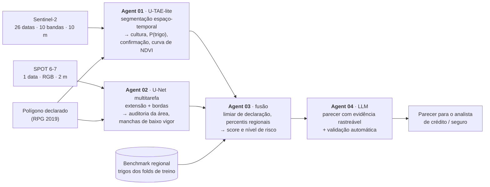

Os Agents 01 e 02 são os modelos de visão computacional treinados neste trabalho. O 03 transforma as saídas deles em decisão, e o 04 as comunica. A orquestração usa LangGraph, com 01 e 02 em paralelo.

### Estrutura do repositório

O projeto está em [`agririsk_v2_pastis/`](agririsk_v2_pastis/): código, artefatos (modelos, métricas, relatórios), figuras deste README ([`docs/figures/`](agririsk_v2_pastis/docs/figures/), geradas por `build_readme_figures.py`), apresentação técnica e [README técnico](agririsk_v2_pastis/README.md) com instruções de reprodução.

### Dados

| Dado | Uso | Fonte e licença |
|---|---|---|
| **PASTIS-HD**: 2.433 recortes de 1,28 km; série Sentinel-2 (38-61 datas, 10 bandas, 10 m); imagem SPOT 6-7 (1,5 m); rótulos de 18 culturas e ids de parcela; 5 folds oficiais separados espacialmente | Treino e avaliação dos Agents 01 e 02 | [IGNF/PASTIS-HD no Hugging Face](https://huggingface.co/datasets/IGNF/PASTIS-HD), etalab-2.0 |
| **RPG 2019**: polígono, cultura e área declarados à Política Agrícola Comum | Rótulos de borda do Agent 02 e objeto da auditoria de área | [IGN Géoplateforme](https://data.geopf.fr/telechargement/resource/RPG), Licence Ouverte |

Foram usados 150 recortes com pelo menos 5% de trigo (30 por fold; ~3 GB baixados) e 10.168 polígonos do RPG. Os dados não são versionados e são regenerados pelos scripts (ver [README técnico](agririsk_v2_pastis/README.md)). Fontes acessadas em 20/11/2026.

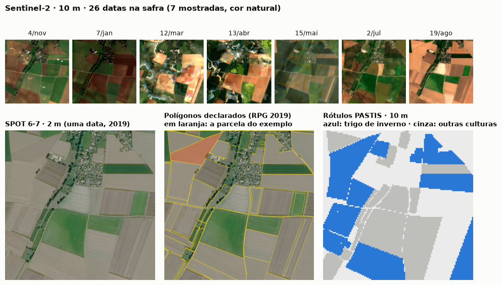

*Um mesmo recorte de 1,28 km nas três fontes. A série Sentinel-2 tem baixa resolução, mas muitas datas (algumas com nuvem, como 12/mar e 13/abr, tratadas no pré-processamento). A SPOT tem alta resolução e uma única data. O polígono do RPG coincide com a parcela do PASTIS (IoU mediana de 0,85 após a rasterização a 2 m).*

**Por que a série temporal?** Numa única data, trigo, cevada e triticale são quase idênticos. O que os separa é o **ciclo**: quando a área fica verde, quando atinge o pico e quando é colhida. O NDVI, `(NIR − Red) / (NIR + Red)`, resume esse ciclo pixel a pixel:

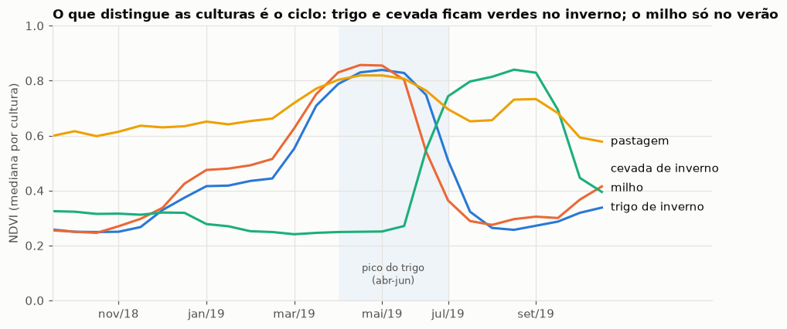

**Pré-processamento** (o mesmo para treino e inferência):

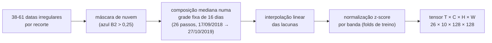

### Protocolo de avaliação

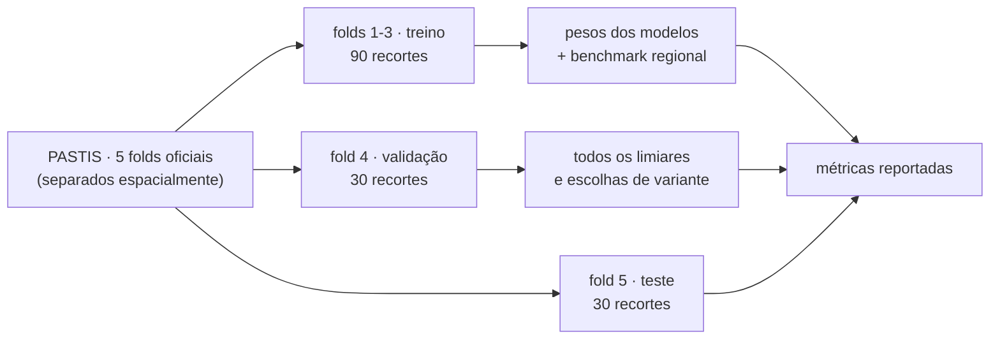

Nenhum número reportado foi usado para escolher hiperparâmetros ou limiares. As fraudes do teste ponta a ponta são simuladas sobre parcelas do fold 5: outra cultura declarada como trigo e polígono ampliado em +30%.

### Agentes e aderência ao curso

Os módulos citados são os da [página do curso](https://ica.ele.puc-rio.br/cursos/computer-vision-master/): (1) fundamentos e programação em Python, (2) aprimoramento de qualidade de imagens, (3) classificação e detecção avançadas, (4) síntese de imagens e modelos generativos.

#### Agent 01 · segmentação espaço-temporal de culturas (U-TAE-lite)

- **O que faz:** segmenta 18 culturas pixel a pixel a partir de 26 imagens Sentinel-2 e decide, por parcela, se a cultura declarada (trigo) é confirmada e desde quando.
- **Técnica:**
    - **Arquitetura:** encoder convolucional compartilhado entre as datas e atenção temporal multi-cabeça por pixel (L-TAE), com codificação senoidal da data. No decoder U-Net, os mesmos pesos de atenção agregam as conexões de cada escala. São 0,56 M de parâmetros.
    - **Treino:** AdamW com OneCycle, 80 épocas, entropia cruzada ponderada e máscara de datas futuras em 50% dos lotes (é isso que permite a confirmação antecipada). Treinado numa GPU T4 do Google Colab em 12 min.

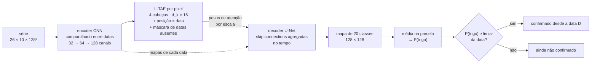

- **Resultados (teste, fold 5):**
    - F1 do trigo por parcela de 0,892 e AUC de 0,987, contra 0,849 e 0,985 do baseline Random Forest.
    - IoU do trigo por pixel de 0,77 e mIoU de 0,41 nas 18 culturas.
    - Até 13/abr, 75% dos trigos confirmados com 90% de precisão.
    - Os erros concentram-se em outros cereais de inverno (triticale, trigo duro, cevada), de fenologia quase idêntica.

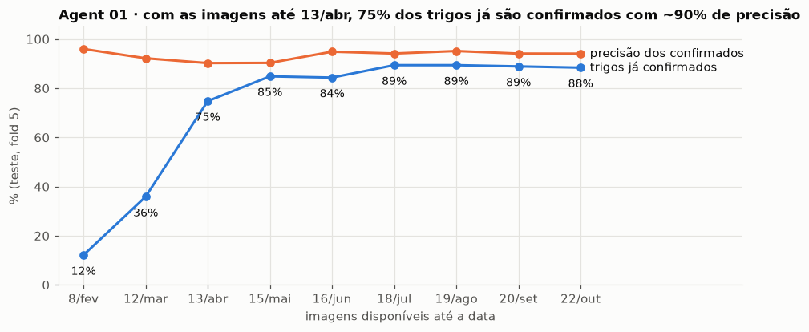

*Cada ponto usa só as imagens disponíveis até aquela data. O limiar de cada data foi escolhido na validação para 95% de precisão e nunca sobe ao longo da safra.*

- **Aderência ao curso:**
    - **Módulo 3:** classificação de imagens com deep learning e CNNs; análise de conteúdo semântico na forma de segmentação semântica densa; avaliação com IoU, mIoU, F1 e AUC.
    - **Módulos 1 e 2:** manipulação de imagens multiespectrais, máscara de nuvens, composição temporal mediana, interpolação e normalização; índice espectral NDVI.
    - **Além do programa:** atenção temporal (o mecanismo dos transformers) aplicada a uma sequência de imagens, e interpretabilidade pela análise dos pesos de atenção.

#### Agent 02 · delimitação de talhões e auditoria de área (U-Net multitarefa)

- **O que faz:** segmenta a extensão cultivada e as bordas entre talhões na imagem SPOT e verifica se o polígono declarado engloba mais do que um talhão, o que indica área declarada a maior.
- **Técnica:**
    - **Modelo:** U-Net com encoder MobileNetV2 pré-treinado no ImageNet (transfer learning) e duas saídas sigmoid (extensão e borda), no estilo do ResUNet-a.
    - **Treino:** perda BCE + Dice com `pos_weight` para a classe rara (borda) e aumentação geométrica e fotométrica. Foram 40 épocas numa T4, em 5 min.
    - **Pós-processamento:** instâncias por watershed sobre a probabilidade de borda.
    - **Auditoria:** compara a faixa externa do polígono com o núcleo. Três variantes foram testadas e a escolha foi feita na validação.

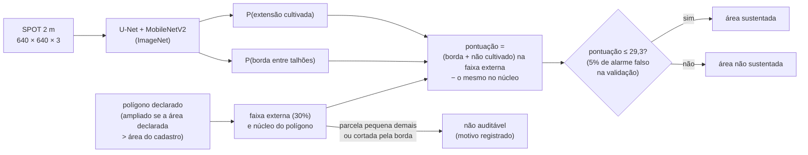

- **Resultados (teste):**
    - IoU de 0,871 na extensão e F1 de borda de 0,760, com tolerância de 4 m.
    - A auditoria detecta 86,5% das áreas infladas em 30% e 66,9% das infladas em 15%, com 5,9% de alarmes falsos. A variante ingênua detectava só 5,8%.
    - Só 48% das parcelas são separadas como instâncias próprias, porque parcelas vizinhas sem borda visível se fundem. Por isso a auditoria usa evidência geométrica, e não a área de cada instância.

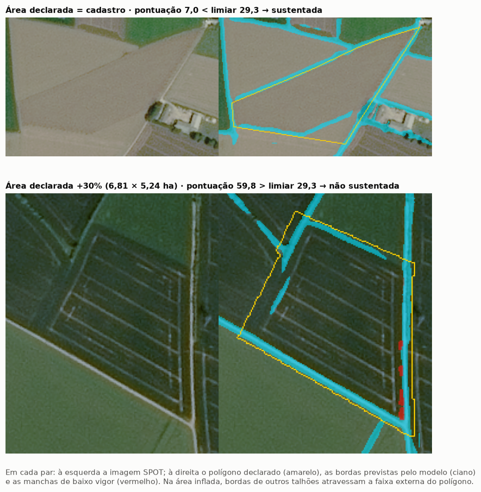

- **Aderência ao curso:**
    - **Módulo 3:** CNN para segmentação; transfer learning; detecção e delimitação de objetos (talhões) e métrica de objetos (IoU de instância).
    - **Módulos 1 e 2:** morfologia matemática (erosão, abertura), componentes conexos, transformada de distância, watershed e índice de vegetação a partir de RGB (VARI) para manchas de baixo vigor; georreferenciamento por transformação afim entre sistemas de coordenadas (Lambert-93 → pixel) para rasterizar os polígonos.

**Treino dos dois modelos de visão** (métricas na validação, fold 4):

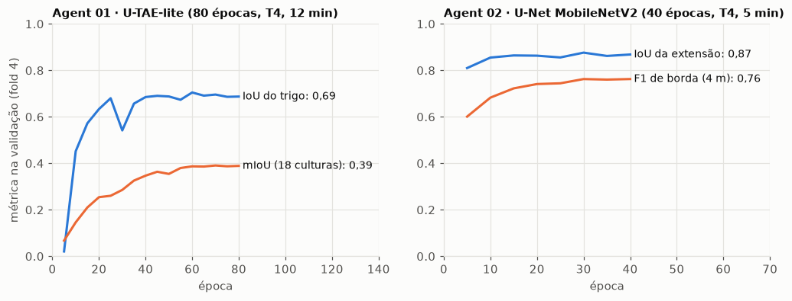

#### Agent 03 · contexto regional e score de risco

- **O que faz:**
    - **Comparação regional:** compara cada parcela com os trigos da mesma região, por percentis do vigor acumulado (integral do NDVI), do NDVI de pico e da data do pico, calculados nos folds de treino.
    - **Score:** combina declaração, área, vigor, ciclo e manchas num score auditável.
    - **Limiar de declaração:** escolhido na validação com no máximo 3% de alarmes em trigos reais. Detecta 87,7% das culturas falsas, com 2,5 alarmes a cada 100 trigos.
- **Fenologia:**
    - A curva é suavizada por mediana móvel de 3 passos.
    - O pico é procurado só entre jan e jul/2019, porque depois da colheita a área pode ficar verde de novo.
    - Em caso de empate, vale o centro do platô.

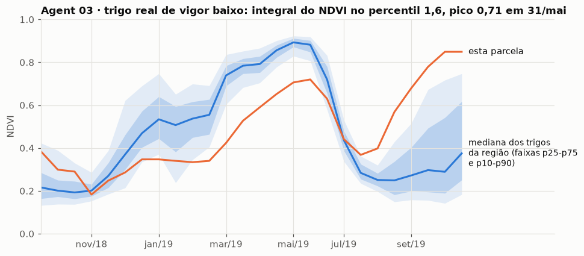

- **Aderência ao curso:** etapa de **integração**, em que as saídas dos modelos de visão viram decisão. Usa processamento de sinais derivados de imagem (suavização por mediana móvel da série de NDVI e métricas fenológicas por meia-amplitude), mas não é, em si, um modelo de visão computacional.

#### Agent 04 · parecer com LLM

- **O que faz:** gera o parecer em linguagem natural a partir das evidências dos Agents 01-03:
    - **Saída:** estruturada por JSON Schema estrito; a evidência citada em cada recomendação é um `enum` com os campos que existem na entrada.
    - **Prompt:** define papel e público, traz um dicionário dos campos e regras para os casos ambíguos encontrados na análise de erros.
    - **Validação e nova tentativa:** se a validação automática reprova, o modelo recebe a lista de problemas e reemite o parecer (1 nova tentativa).
    - **Modelo:** gpt-5.4-mini. Nas 60 parcelas, passou na validação em todas já na 1ª tentativa, com a mesma qualidade do gpt-5.4 e cerca de 1/3 da latência. Roda numa VM de CPU do Colab.

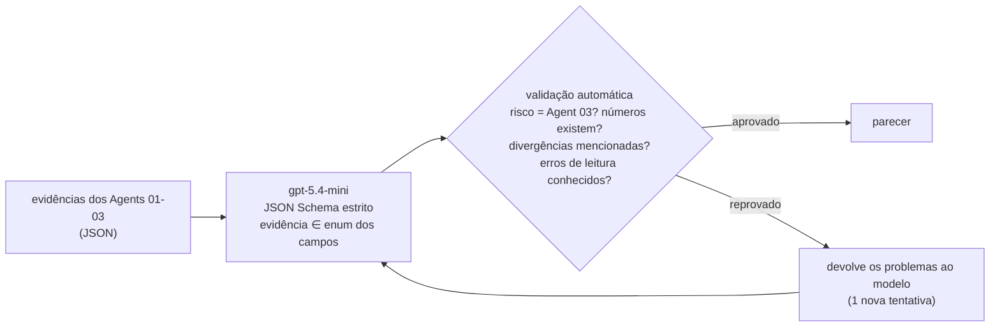

- **Aderência ao curso:** **camada de aplicação**, fora do escopo de visão computacional. Mostra como comunicar a saída dos modelos de forma rastreável a um usuário não técnico.

> **Módulo 4 (síntese de imagens e modelos generativos)** não é coberto. Uma extensão natural seria a super-resolução da série Sentinel-2 guiada pela imagem SPOT.

### Exemplos ponta a ponta

Seis parcelas do teste (fold 5), uma por situação. Os relatórios completos, com o parecer do Agent 04, estão em [`artifacts/reports/`](agririsk_v2_pastis/artifacts/reports/) e na [apresentação em PDF](agririsk_v2_pastis/docs/AgriRisk_MA_v2_apresentacao.pdf) (páginas 21 a 26).

| Situação | Agent 01 · série temporal | Agent 02 · imagem | Agent 03 · região | Risco |
|---|---|---|---|---|
| Trigo honesto e saudável (10259_1147481) | P(trigo) 0,90 · confirmado desde 13/abr | área sustentada (7,0 < 29,3) | vigor no percentil 98,7 | **baixo** (0,09) |
| Trigo real com vigor muito baixo (30455_50323) | P(trigo) 0,19: passa no limiar, nunca é confirmado | área sustentada | vigor no percentil 1,6 · pico 16 dias depois da região | **alto** (0,62): vistoria |
| Trigo que fica verde depois da colheita (40025_7275742) | P(trigo) 0,74 · confirmado desde 12/mar | área sustentada | percentil 64,8 · pico em 16/jun (o rebrote de set-out é ignorado) | **baixo** (0,21) |
| Área declarada +30% (10270_1110439) | P(trigo) 0,90 · confirmado desde 13/abr | **não sustentada** (59,8 > 29,3) · 6,81 × 5,24 ha | percentil 32,0 | **alto** (0,55) |
| Milho declarado como trigo (30455_13881546) | **P(trigo) 0,002** · mais provável: milho | área sustentada | não se aplica (cultura não confirmada) | **alto** (0,70) |
| Área +30% numa parcela de 1,08 ha (40025_13362682) | P(trigo) 0,87 · confirmado desde 8/fev | **não auditável** (parcela pequena demais) | percentil 84,7 | baixo (0,19), com a limitação sinalizada |

No teste ponta a ponta com 60 parcelas, o resultado por cenário foi:
- **Cultura falsa:** 12 de 12 com risco alto.
- **Área +30%:** 10 de 12 detectadas; as outras 2 foram marcadas como não auditáveis.
- **Declarações honestas:** 28 com risco baixo, 3 médio e 5 alto. Dos 5 altos, 3 são alarmes falsos da auditoria de área, 1 é alarme falso da conferência de cultura (P(trigo) = 0,05) e 1 é o trigo de vigor muito baixo do exemplo acima.

### Resultados principais

| Tarefa | Métrica (teste, fold 5) | Valor |
|---|---|---|
| Identificar trigo por parcela (Agent 01) | F1 / AUC | **0,892 / 0,987** (Random Forest: 0,849 / 0,985) |
| Confirmação antecipada (Agent 01) | Trigos confirmados até 13/abr (precisão) | **75%** (90%) |
| Delimitação (Agent 02) | IoU da extensão / F1 de borda (4 m) | **0,871 / 0,760** |
| Auditoria de área (Agent 02) | Detecção de área +30% / alarme falso | **86,5% / 5,9%** |
| Conferência de cultura (Agent 03) | Culturas falsas detectadas / alarmes por 100 trigos | **87,7% / 2,5** |
| Parecer (Agent 04) | Pareceres aprovados na validação (60 parcelas) | 100% na 1ª tentativa (gpt-5.4-mini) |

### Reprodução

Toda a execução roda no Google Colab via [google-colab-cli](https://github.com/googlecolab/google-colab-cli). Localmente ficam só a edição do código e a montagem da apresentação e das figuras.

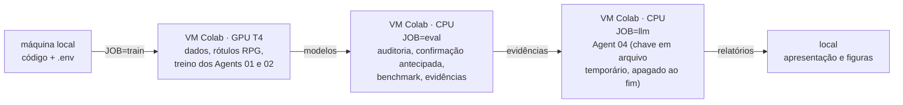

Os passos, a configuração e os scripts estão no [README técnico](agririsk_v2_pastis/README.md).

### Limitações

- **Instâncias:** o rótulo administrativo (parcela declarada) nem sempre corresponde a uma fronteira visível na imagem.
- **Fraudes:** são simuladas (outra cultura declarada como trigo; polígono ampliado em +15% e +30%).
- **Abrangência:** uma safra (2018-19), uma região geográfica (França) e 150 dos 2.433 recortes.
- **Vigor:** não foi validado contra produtividade.
- **Parcelas pequenas:** abaixo de ~1,5 ha a auditoria de área não separa a faixa externa do núcleo; a parcela é marcada como não auditável (6 das 60 parcelas do teste ponta a ponta).

---

Matrícula: 242.100.131

Pontifícia Universidade Católica do Rio de Janeiro

Curso de Pós-Graduação *Visão Computacional Master* (VC Master)
◊