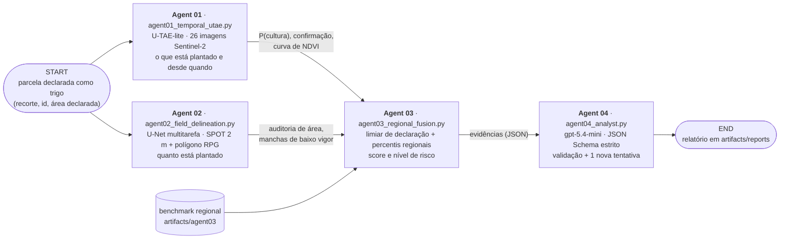

# AgriRisk-MA · Trigo de inverno · PASTIS-HD

Sistema multiagente que confere um talhão **declarado como trigo de inverno**: **o que** está
plantado (e **desde quando** dá para confirmar), **quanto** está plantado (a área declarada é
sustentada pela imagem?) e **como** ele se compara aos trigos **da mesma região**. Combina a série
temporal Sentinel-2, a imagem SPOT de alta resolução e o polígono declarado **da mesma parcela**,
e entrega um parecer rastreável para o analista de crédito rural.

- **Apresentação:** [PDF](docs/AgriRisk_MA_v2_apresentacao.pdf) · [HTML interativo](docs/AgriRisk_MA_v2_apresentacao.html) (o GitHub não renderiza HTML: baixe e abra no navegador)

## Arquitetura

Grafo LangGraph ([`orchestrator.py`](orchestrator.py)): os Agents 01 e 02 rodam em paralelo sobre a
mesma parcela, o 03 sincroniza os dois e o 04 escreve o parecer.



Na execução em lote, os Agents 01-03 rodam na VM de avaliação (`--export-payloads` grava as
evidências em `artifacts/payloads`) e o Agent 04 roda depois, na VM do job `llm`
(`--from-payloads`).

| Agente | Modelo | Por quê |
|---|---|---|
| 01 · espaço-temporal | U-TAE-lite (0,56 M parâmetros): encoder por data + atenção temporal por pixel + decoder U-Net, treinado com **cortes temporais aleatórios** | Identificar a cultura é um problema temporal; um único modelo responde "dá para confirmar com o que se viu até a data D?" |
| 02 · delimitação | U-Net + MobileNetV2 multitarefa (extensão cultivada + borda) + auditoria geométrica da área declarada | A alta resolução brilha em geometria: bordas, carreadores, áreas não cultivadas |
| 03 · região e risco | Limiar de declaração com ≤ 3% de alarmes em trigos reais + percentis entre os trigos da mesma região (folds de treino) | Risco relativo aos vizinhos, com score decomposto por componente |
| 04 · parecer | gpt-5.4-mini com structured outputs, evidência em `enum`, validação pós-geração e 1 nova tentativa se reprovar | Mesma qualidade do gpt-5.4 com ~1/3 da latência |

## Dados (fontes públicas, acessadas em 20/11/2026)

| Dado | Fonte | Licença | Como é obtido |
|---|---|---|---|
| PASTIS-HD: Sentinel-2 (série), SPOT 6-7 (1,5 m), rótulos de cultura e ids de parcela | https://huggingface.co/datasets/IGNF/PASTIS-HD | etalab-2.0 | `prepare_data.py` (só os recortes selecionados) |
| Índice dos recortes com trigo | gerado das anotações do PASTIS-HD | — | `build_wheat_index.py` → `data_index/wheat_patches.json` (commitado) |
| RPG 2019, Registre Parcellaire Graphique (polígono, cultura e área declarados à PAC) | https://data.geopf.fr/telechargement/resource/RPG · pacotes `RPG_2-0_SHP_LAMB93_R{27,28,44,76,84,93}-2019` | Licence Ouverte (etalab) | `prepare_rpg.py extract` → `data_index/rpg_polygons.json.gz` (commitado, 1,6 MB, 10.168 polígonos) |

- **Não versionado:** `data/` (~2,7 GB: recortes processados, `.7z` do RPG, rótulos rasterizados).
  Tudo é regenerado pelos scripts acima, e os índices commitados preservam a seleção exata.
- **Seleção determinística:** 30 recortes por fold oficial com ≥ 5% de trigo, regiões em rodízio,
  semente fixa **por fold** (a seleção de um fold não depende dos outros).
- **Ligação entre fontes:** o `ID_PARCEL` do RPG é o id de parcela do PASTIS. A rasterização do
  RPG coincide com os rótulos do PASTIS (IoU mediana 0,85, ver `prepare_rpg.py check`).
- **Dependência externa:** se Hugging Face ou IGN mudarem os arquivos, o download quebra. Os
  índices commitados e a versão do RPG (2019) documentam exatamente o que foi usado.

## Protocolo

Folds oficiais do PASTIS: **1-3 treino, 4 validação, 5 teste**. As 4 regiões (tiles Sentinel-2)
aparecem em todos os folds: treino e teste vêm das **mesmas regiões**, em recortes diferentes.
Todo limiar é escolhido na validação e reportado no teste.

## Resultados (teste = fold 5)

| Métrica | Valor |
|---|---|
| Agent 01 · trigo por parcela, safra completa: F1 / AUC | **0,892 / 0,987** (baseline Random Forest na curva média: 0,849 / 0,985) |
| Agent 01 · confirmação antecipada (limiar por data, alvo de 95% de precisão na validação, **monotônico**: nunca sobe ao longo da safra) | 13/abr: **75%** dos trigos confirmados (precisão de 90% no teste) · 15/mai: 85% (90%) · 16/jun: 84% (95%) |
| Agent 02 · delimitação: IoU da extensão / F1 de borda (tolerância 4 m) | **0,871 / 0,760** |
| Agent 02 · auditoria de área, com 5% de alarme falso na validação | detecta **86,5%** das áreas infladas em +30% e 66,9% das infladas em +15% (alarme falso no teste: 5,9%); a variante B (faixa externa − núcleo) foi escolhida na validação entre 3 |
| Agent 03 · conferência da cultura declarada (limiar com ≤ 3% de alarmes na validação) | detecta **87,7%** das culturas falsas, com **2,5 alarmes** a cada 100 trigos reais |
| Pipeline · 60 parcelas de teste em 3 cenários | cultura falsa: 12/12 com risco alto · área +30%: 10/12 detectadas (2 não auditáveis, sinalizadas) · honestas: 28 baixo, 3 médio, 5 alto |
| Agent 04 · pareceres que passam na validação (60 parcelas) | gpt-5.4-mini **100% na 1ª tentativa** (latência mediana 3,2 s) · gpt-5.4 100% (10 s). A validação inclui checagens dos erros de leitura vistos na análise de erros (declaração consistente chamada de "não confirmada", área não auditável comparada a um limiar) |

Métricas completas em `artifacts/agent0*/metrics.json`, comparação das variantes da auditoria
em `artifacts/agent02/audit_variants.json` e comparação dos LLMs em `artifacts/agent04/`.

## Como reproduzir

Toda a execução roda no **Google Colab** (google-colab-cli): treino em GPU T4 e o resto
(inferência, avaliações, benchmark e o Agent 04) em VMs só com CPU. Para o Agent 04, só a linha
`API_KEY_GPT` do `.env` vai para a VM, num arquivo com permissão 600 apagado ao fim do job.
Localmente fica só a montagem da apresentação.

**Versões do Python:**

| Onde | Python | Principais pacotes |
|---|---|---|
| Local (edição, apresentação, figuras) | **3.14.2** | torch 2.15.0 (CPU), numpy 2.5.4, opencv 5.1.0, openai 3.57.0 |
| VMs do Google Colab (treino na T4; avaliação e Agent 04 na CPU) | **3.13.18** (o da imagem do Colab, sem reinstalar) | torch 2.14.1 e numpy 2.4.6 da imagem; o resto via `pip install` nos scripts `colab_remote_*.sh` |

Versões conferidas em 22/11/2026. A imagem do Colab é atualizada pelo Google, então numa
execução futura a versão pode ser outra.

```bash
# ambiente local (a partir da raiz do repositório)
python -m venv .venv && source .venv/bin/activate
pip install --index-url https://download.pytorch.org/whl/cpu torch torchvision
pip install -r agririsk_v2_pastis/requirements.txt pyproj pyshp py7zr playwright && playwright install chromium
cd agririsk_v2_pastis

# Colab: login uma vez
uv tool install google-colab-cli --with keyrings.alt
export PYTHON_KEYRING_BACKEND=keyrings.alt.file.PlaintextKeyring
colab sessions

# (opcional) regenerar os índices commitados
python build_wheat_index.py --check     # recontagem do trigo nas anotações (rodar no Colab)
python prepare_rpg.py extract           # baixa o RPG 2019 do IGN e recorta os polígonos

# 1) treino na GPU: dados, rótulos RPG, Agents 01 e 02
JOB=train ./run_on_colab.sh up && JOB=train ./run_on_colab.sh status   # até AGRIRISK_DONE
JOB=train ./run_on_colab.sh fetch && JOB=train ./run_on_colab.sh down

# 2) avaliação na CPU do Colab: auditoria, confirmação antecipada, benchmark, evidências
JOB=eval ./run_on_colab.sh up            # HIGH_MEM=1 para máquina maior
JOB=eval ./run_on_colab.sh fetch && JOB=eval ./run_on_colab.sh down

# 3) Agent 04 na CPU do Colab (chave API_KEY_GPT no .env da raiz)
JOB=llm LLM_TASK=reports PARCELS="30455_50323" ./run_on_colab.sh up    # relatórios ponta a ponta
JOB=llm LLM_TASK=eval LLM_MODELS="gpt-5.4-mini gpt-5.4" ./run_on_colab.sh sync   # comparação de LLMs
JOB=llm ./run_on_colab.sh fetch && JOB=llm ./run_on_colab.sh down

# 4) local: apresentação
python build_presentation.py && python export_presentation.py   # HTML → PDF (uma página por slide)
python build_readme_figures.py # figuras do README da raiz → docs/figures/ (só lê dados e artefatos)
```

## Artefatos

| Caminho | Conteúdo |
|---|---|
| `artifacts/agent01/` | U-TAE-lite, normalização, métricas (pixel, parcela, baseline, confirmação por data, atenção) e predições por parcela |
| `artifacts/agent02/` | modelo de delimitação, métricas, comparação das 3 variantes da auditoria, evidências visuais |
| `artifacts/agent03/` | benchmark regional, limiar de declaração e métricas |
| `artifacts/payloads/` | evidências dos Agents 01-03 por parcela (entrada do Agent 04) |
| `artifacts/agent04/`, `artifacts/reports/` | comparação de LLMs e relatórios ponta a ponta |ß

## Referências

Sainte Fare Garnot & Landrieu, ICCV 2021 (PASTIS, U-TAE) · Astruc et al., ECCV 2024 (OmniSat,
PASTIS-HD) · Waldner & Diakogiannis, RSE 2020 (ResUNet-a, delimitação de talhões) · IGN/ASP,
RPG 2019 · Resoluções CMN 4.427/2015 e 5.267/2025 (fiscalização do crédito rural por
sensoriamento remoto).
